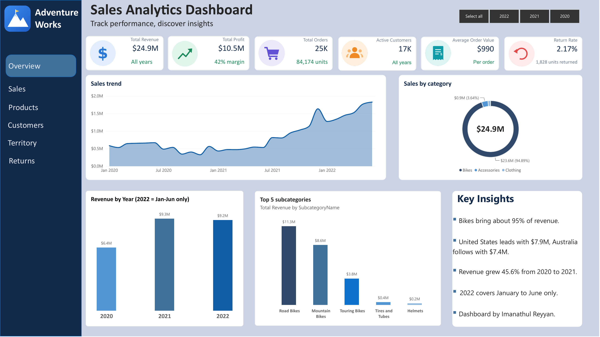
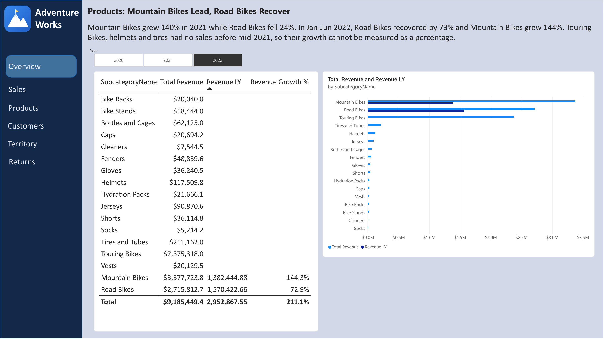
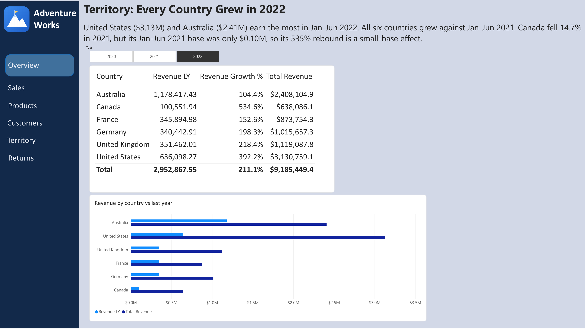
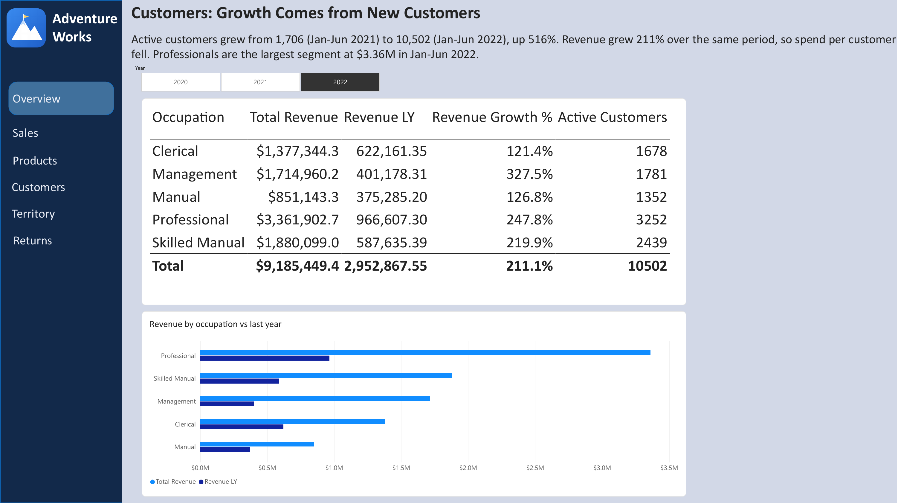
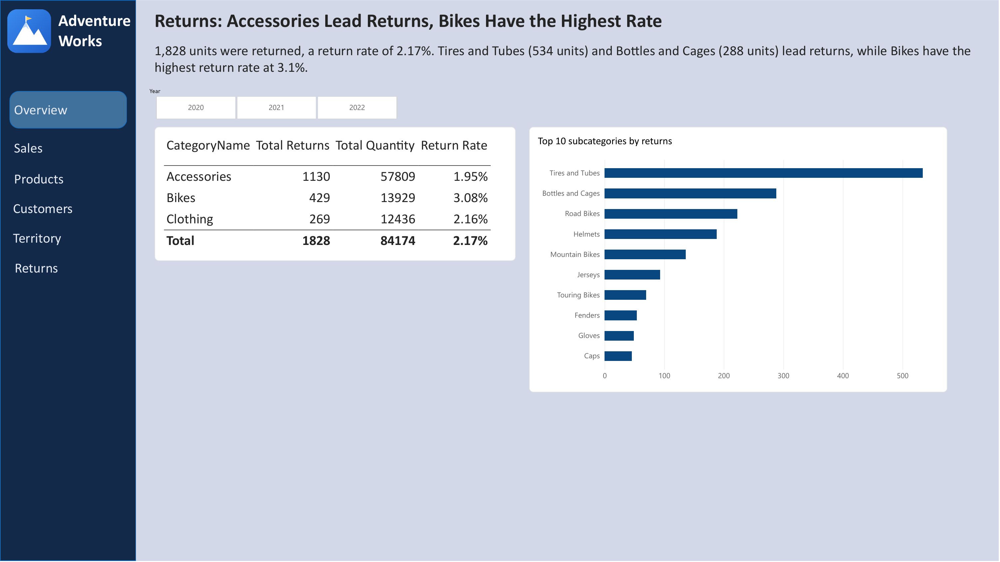

# 📊 AdventureWorks Sales Dashboard: Power BI Analysis

A six-page Power BI dashboard that finds which products, regions and customers grow revenue. 56,046 sales rows, 10 source files, one clear answer: **growth came from new customers and from product lines launched in July 2021, and the USA and Australia earn 61.7% of revenue.**

## 📌 Project Overview

AdventureWorks is a sample company that sells bikes, accessories and clothing. This project asks one business question:

> **Which products, regions and customers grow revenue?**

I loaded and cleaned 10 CSV files in Power Query, built a data model with DAX measures, and designed a dashboard with one page for each part of the question.

| | |
|---|---|
| Revenue analysed | $24.9M |
| Profit | $10.5M (42% margin) |
| Period | 1 Jan 2020 to 30 Jun 2022 |
| Orders | 25,164 (84,174 units) |
| Customers | 17,416 active customers |
| Sales regions | 6 countries |
| Products | 293, in 37 subcategories (3 categories have sales) |

## 🛠️ Tools Used

- **Power BI Desktop** (data model, dashboard, slicers)
- **Power Query** (loading and cleaning 10 CSV files)
- **DAX** (measures for revenue, profit, growth, customers and returns)

## 🖼️ Dashboard Preview

### Overview


### Products


### Territory


### Customers


### Returns


The dashboard has 6 pages (Overview, Sales, Products, Customers, Territory and Returns). Every page has a Year slicer, and the full export of all pages is in [`AdventureWorks_Dashboard.pdf`](AdventureWorks_Dashboard.pdf).

## 🗂️ Data Model

The model has 8 tables: two fact tables and six dimension tables.

| Table | Rows | What it holds |
|---|---|---|
| `fact_Sales` | 56,046 | One row per order line: date, product, customer, territory, quantity |
| `fact_Returns` | 1,809 | One row per return: product, territory, quantity returned |
| `dim_Customer` | 18,148 | Customer details such as occupation, education and income |
| `dim_Product` | 293 | Product name, cost and price |
| `dim_Subcategory` | 37 | Product subcategory |
| `dim_Category` | 4 | Product category (Bikes, Accessories and Clothing have sales) |
| `dim_Territory` | 10 | Region and country |
| `dim_Calendar` | 912 | One row per day, 1 Jan 2020 to 30 Jun 2022 |

Relationships (all one-to-many, single direction):
`dim_Calendar`, `dim_Product`, `dim_Customer` and `dim_Territory` → `fact_Sales`; `dim_Product` and `dim_Territory` → `fact_Returns`; `dim_Category` → `dim_Subcategory` → `dim_Product`.

**Revenue** is order quantity × product price, and **profit** is revenue minus quantity × product cost.

## 🧮 DAX Measures

| Measure | What it shows |
|---|---|
| Total Revenue | Quantity × price of everything sold |
| Total Cost | Quantity × product cost |
| Total Profit | Revenue minus cost |
| Profit Margin % | Profit divided by revenue |
| Total Orders | Number of distinct orders |
| Total Quantity | Units sold |
| Total Returns | Units returned |
| Return Rate | Units returned divided by units sold |
| Revenue LY | Revenue for the same period one year earlier |
| Revenue Growth % | Revenue compared with Revenue LY |
| Active Customers | Customers who bought in the selected period |
| Average Order Value | Revenue divided by orders |

```dax
Revenue Growth % = DIVIDE([Total Revenue] - [Revenue LY], [Revenue LY])
Active Customers = DISTINCTCOUNT(fact_Sales[CustomerKey])
Average Order Value = DIVIDE([Total Revenue], [Total Orders])
```

`Revenue LY` uses the calendar table, so when the 2022 slicer is selected it compares January to June 2022 with January to June 2021. This keeps the comparison fair, because the data stops on 30 June 2022.

## 🧹 Data Cleaning

| Step | Issue found | Fix |
|---|---|---|
| 1 | The customer file had 6 junk rows at the end (text in the key column, an export date and a source note) | Removed them: 18,154 rows became 18,148 |
| 2 | Customer names showed wrong characters | Loaded that file with Western European (1252) encoding |
| 3 | Gender was `NA` for some customers | Replaced with `Unknown` |
| 4 | Sales were split into three files (2020, 2021, 2022) | Appended them into one `fact_Sales` table (56,046 rows) |
| 5 | Product colour, size and style used `NA` and `U` for "not applicable" | Kept as valid values |
| 6 | Dates and numbers needed the correct data types | Set the data type of every column |
| 7 | Product, subcategory and category lived in three files | Linked them with relationships |
| 8 | KPI check | Revenue, profit, orders, units and return rate match values calculated separately from the CSV files |

## 💡 Key Insights

1. **Revenue grew 45.6% from 2020 to 2021** ($6.40M to $9.32M). In January to June 2022 it reached **$9.19M, 3.1 times** the same months of 2021 ($2.95M, +211%). Profit margin stayed between 41% and 43% every year.
2. **Bikes earn 94.9% of revenue.** Road Bikes lead with $11.29M, then Mountain Bikes ($8.58M) and Touring Bikes ($3.77M).
3. **About half of the 2022 growth came from new product lines.** Touring Bikes, accessories and clothing all launched on 1 July 2021. Of the $6.2M rise in January to June 2022, $3.1M came from them and $3.1M (50.4%) from Road and Mountain Bikes.
4. **Mountain Bikes grew in both periods; Road Bikes recovered.** Mountain Bikes grew 139.7% in 2021 and 144.3% in January to June 2022. Road Bikes fell 24.1% in 2021, then rose 72.9% in January to June 2022.
5. **The USA ($7.94M) and Australia ($7.42M) earn 61.7% of revenue.** The United Kingdom, Germany and France grew fastest in 2021 (114.5%, 99.4% and 95.8%). Every country grew in January to June 2022. Canada fell 14.7% in 2021 but started from only $0.10M.
6. **Growth comes from new customers, not higher spending.** Active customers rose from 1,706 (January to June 2021) to 10,502 (January to June 2022), which is +516%, while revenue rose 211%. Average order value fell from $2,435 in 2020 to $872 in 2021 and $776 in 2022.
7. **Revenue is not concentrated in a few customers.** The top 10 customers earn only 0.44% of revenue. Professionals are the largest segment ($8.47M), and Management grew fastest in January to June 2022 (+327.5%).
8. **Bikes are returned most often.** The overall return rate is 2.17% (1,828 units), but Bikes are returned at 3.08% versus 1.95% for Accessories and 2.16% for Clothing.

### 🎯 Recommendations

- Keep investing in Mountain Bikes and Road Bikes, which carry most of the revenue.
- Look at why average order value keeps falling, for example by pairing accessories with bike sales.
- Review the 3.1% return rate on Road Bikes and Helmets.
- Explore growth in the United Kingdom, Germany and France, which grew faster than the USA in 2021.

### ⚠️ Limitations

- AdventureWorks is a **sample dataset**. Customer behaviour is more uniform than in a real company (for example, every 2020 customer bought exactly one unit), so the customer findings describe this sample only.
- The data ends on 30 June 2022, so 2022 is compared with January to June 2021, not with the full year 2021.
- Growth is mixed with the July 2021 product launch. New products have no earlier sales, so their growth cannot be shown as a percentage.
- Revenue uses the list price in the product table. The data has no discounts, so real revenue may differ.
- Growth percentages on small bases (such as Canada in 2021) look large and need the dollar values beside them.

## ▶️ How to Open

1. Install [Power BI Desktop](https://powerbi.microsoft.com/desktop/) (free).
2. Download [`AdventureWorks_Sales_Dashboard.pbix`](AdventureWorks_Sales_Dashboard.pbix) and open it.
3. If Power BI shows a data source error, go to **Home → Transform data → Data source settings**, choose **Change Source** and point each file to the [`data/`](data/) folder.
4. Use the Year slicer on each page. Select **2022** to compare January to June 2022 with January to June 2021.

## 📁 Project Structure

```
powerbi-adventureworks-sales-dashboard/
├── README.md
├── AdventureWorks_Sales_Dashboard.pbix
├── AdventureWorks_Dashboard.pdf
├── data/
│   ├── AdventureWorks_Calendar_Lookup.csv
│   ├── AdventureWorks_Customer_Lookup.csv
│   ├── AdventureWorks_Product_Categories_Lookup.csv
│   ├── AdventureWorks_Product_Lookup.csv
│   ├── AdventureWorks_Product_Subcategories_Lookup.csv
│   ├── AdventureWorks_Returns_Data.csv
│   ├── AdventureWorks_Sales_Data_2020.csv
│   ├── AdventureWorks_Sales_Data_2021.csv
│   ├── AdventureWorks_Sales_Data_2022.csv
│   └── AdventureWorks_Territory_Lookup.csv
└── images/
    ├── overview.png
    ├── products.png
    ├── territory.png
    ├── customers.png
    └── returns.png
```

## 📚 Dataset

AdventureWorks sample data (10 CSV files), downloaded from Kaggle. It describes a fictional bicycle company, so the findings describe this sample only.

## 👤 Author

**Imanathul Reyyan**, BSc Applied Data Analytics, University of Colombo

🌐 [Portfolio](https://imanathulreyyan.github.io) | 💼 [LinkedIn](https://www.linkedin.com/in/imanathul-reyyan)
